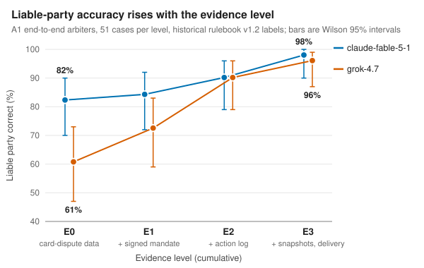

# 1. Introduction

Card disputes already name most of what goes wrong in a purchase: goods not received, goods not as described, a wrong amount and, where the cardholder did not authorise the payment, fraud. An AI agent that buys on a user's behalf adds a case those categories do not name. The agent had permission. It stayed inside the spending limit. The merchant delivered what the agent ordered. And the user still says: this is not what I wanted. Either the agent broke an instruction, or it failed to write down a requirement the user stated, or the user wanted something never said. The dispute is about the faithful execution of delegated intent, and today it is misfiled as not as described, absorbed by the issuer, or refused as authorised. The record that could decide it, the user's instruction to the agent and what the agent did with it, is held by the AI provider, outside the scheme's evidence rules.

The rest of the agent purchase has moved quickly. AP2 defines signed mandates and a merchant-signed checkout and has been contributed, with Mastercard's Verifiable Intent, to the FIDO Alliance [@ap2spec; @fido2026]; UCP and ACP define catalogues and checkout [@ucp; @ucpblog2026; @acp]; Visa and Mastercard identify agents and issue agent-scoped tokens [@visatap2025; @mastercardagentpay2025]. On liability the market has split: Visa's rules hold the cardholder responsible for an agentic provider's in-mandate actions "as if the Cardholder initiated the Transaction" [@visarules2026], while American Express has announced, for US credit cards and registered agents, protection where "the purchase deviates from the Card Member-authenticated purchase intent" [@amex2026; @amexdive2026]. Whoever enforces such a line has to decide, from records, what an agent was told and what it did, while the buyer, the merchant and the provider each gain by shading the truth. Increasingly the decider will be an AI. That makes agent disputes a concrete case of scalable oversight [@irving2018; @greenblatt2023]: a judge reads records of agreement and action, and parties with a stake write part of the evidence.

This paper asks three questions of AI dispute arbiters on synthetic disputes with known ground truth. Does a richer evidence package make them accurate? Does that survive a party that optimises the evidence it writes? And what does a defence built after seeing such attacks cost? The answers form one line. Evidence helps: with the full package two end-to-end arbiters reach 98% and 96% liable-party accuracy on 51 ordinary and scripted-adversarial disputes. Optimised fabrication defeats it: a party that rewrote only its own submissions fooled the same arbiters on 12 and 14 of 14 case-sides, with signed and chained records in evidence. And the defences built afterwards trade safety against usefulness: in one frozen, held-out test, a gate that checks what each cited record says stopped every attack by an attacker that saw its verdicts, but sent two in three ordinary disputes, true claimants included, to a human.

**Contributions.** (1) A reproducible failure analysis: an adaptive evidence-fabrication attack on AI dispute arbiters, with ground truth, a whitelist that keeps every record except the attacking party's own byte-identical, transfer across model families, and the moves that worked (Section 6). (2) A paired measurement of what each evidence level buys an AI arbiter on ordinary disputes (Section 5). (3) A safety-usefulness accounting of the defences built after the attacks: a provenance gate as run, its revisions v2 and v3 and a hybrid decision contract v3, replayed on stored outputs, and one frozen, held-out test of gate v3 against a gate-aware attacker (C1, Section 7). (4) A short design response to the question the results leave, who may confirm the fact that decides an agent dispute, with a staged path by which schemes could adopt agent dispute codes; it is design, not evaluated (Section 8). The taxonomy and evidence package come from a companion standard, the Agentic Buying Standard (ABS v0.3). Section 3 summarises what the experiments need; the normative detail (envelope and schemas, settlement mapping, Decision Center governance, segments) is in Appendices A and B and in the standard itself. A rule-completeness simulation of the standard and an evaluation of shopping agents under payment controls are supporting results (Appendices C and D).

Two AI reviews of earlier versions shaped this one. The first [@audit1] recommended rejection. An independent re-check [@audit3] then rated its 30 findings 13 closed, 16 partly closed and 1 open, and found 8 new ones. The counterexamples both gave were reproduced by failing tests and repaired, the reporting errors are corrected here, and of the experiments that would close the remaining gaps the matched gate test has run (C1, Section 7); the rest are planned, not run (Section 9.5).

# 2. Background and related work

**Payments.** AP2 v0.2 states that "how this is used for dispute resolution, retention, and retrieval requirements are outside the scope of this specification" [@ap2spec]; ACP leaves refunds and chargebacks with the merchant and its PSP [@acp]; UCP keeps the business as merchant of record [@ucp; @ucpblog2026]. Visa's rules (24 October 2026) require consent to a cardholder-defined payment instruction with an expiry and an order confirmation kept for at least 120 days, and oblige a registered agentic provider to give the cardholder's instruction to the cardholder or issuer on written request [@visarules2026]. None defines an agent-specific dispute reason code, a decision order for an authorised-but-wrong purchase or an evidence standard. The card lifecycle is the only mature cross-party dispute machinery in retail payments; pre-dispute alerts prevented more than 39 million chargebacks in 2025 [@ethoca2026]. Account-to-account rails have no chargeback, and the UK's reimbursement of push-payment scams excludes civil disputes with a legitimate supplier [@psrapp; @psrcivil2024]. EU consumer ADR requires independence and preserves access to court [@adr2013]; the AAA-ICDR's AI arbitrator keeps a human on every award [@aaa2025].

**Oversight and adversarial judging.** Debate before a weaker judge was proposed for scalable oversight [@irving2018]; more persuasive debaters raised judge accuracy above a single-advocate consultancy baseline [@khan2024], with gains that depend on the task [@kenton2024]; AI control studies a trusted but weaker monitor overseeing a stronger, possibly subversive model, and frames defences as a trade-off between safety and usefulness [@greenblatt2023]. LLM judges carry position, verbosity and self-enhancement biases [@zheng2023] and can be steered by optimised sequences aimed at the judge [@judgedeceiver2024]; reference-based reward-model verification can be fooled by a single token [@judgeflip2025]. Tool-using agents are vulnerable to indirect prompt injection [@agentdojo2024; @wasp2025]; CaMeL separates control flow from data so that instructions found in data are never followed [@camel2025], the argument behind this paper's typed findings. In a simulated agent market, seller-side persuasion and injection redirected several models' payments [@magentic2025]; page position swings agent choice [@allouah2025]. Project Vend's shop-running models were talked into discounts and free items [@vend1; @vend2]; Anthropic reports 1.4% attack success for Claude Opus 4.5 with improved safeguards against an adaptive attacker given 100 attempts, 8.0% model-only [@anthropicpi2025]. The closest prior work is CyberJurors [@cyberjurors2026], a multi-agent LLM jury over VerdictBench, 6,000 real multimodal e-commerce disputes: real cases at scale and multimodal input, which this paper lacks. None of these has an agent-initiated purchase under a mandate, the authorised-but-wrong liability split, an evidence standard measured level by level, or constructed adversarial evidence with ground truth; that is the gap this paper addresses.

# 3. The delegated-intent gap and the evidence package

The experiments need three things from ABS v0.3: a taxonomy that names the delegated-intent disputes, a decision order that turns established facts into a liable party, and evidence levels. ABS is a dispute, evidence and liability profile on the protocols above and on existing card and ISO 20022 flows, not a payment protocol. It keeps every rail and statutory right of the buyer, holds no funds, and never lets a party act as arbiter where it holds another role. Appendix B summarises the rest of the core, and the standard (`standard/ABS_v0.3.md`) is the reference.

**Taxonomy.** Merchant-performance claims keep the category an issuer or merchant uses today; the codes new to disputes are the three about delegated intent, AG1-P, AG1-C and AG2.

| Code | Name | Liable | Existing category extended |
|---|---|---|---|
| AG0 | No valid mandate | Rail process | Unauthorised / fraud (routed out of ABS to the rail) |
| AG3 | Non-conformity: not received, differs from the frozen offer, counterfeit, over-charge | Merchant | Not received; not as described; incorrect amount (reference: the countersigned snapshot) |
| AG4 | Injection via merchant content | Merchant | Not as described (new sub-reason) |
| AG4-D | Deceptive offer content (false reference price, scarcity, endorsement) that influenced the choice | Merchant | Misrepresentation |
| AG1-M | Merchant-added items or fees the agent did not choose | Merchant | Processing error; not as described |
| AG1-P | Instruction dispute: a term captured in the signed mandate broken, or a guess where told to ask | Agent provider | None: authorised and performed |
| AG1-C | Capture dispute: a requirement the user stated only in the conversation that the agent, which drafted the mandate, did not capture | Agent provider | None |
| AG2 | Authorised but wrong: fits every captured term, not what the user meant and never said | Buyer | None |
| AG5 | User error, change of mind, or a false claim | Buyer | None (carries a conduct finding) |

**Decision order.** The precision of the mandate decides. After standing, Step 0 (authorisation, AG0) belongs to the payer's PSP. Step 1, conformity: if what arrived does not match the merchant-countersigned Offer Snapshot within its tolerances, the merchant is liable whatever the agent did (AG3). Step 2, manipulative offer: the delivery conforms but content the merchant controls caused the purchase (AG4, AG4-D), or the merchant added lines or worse terms (AG1-M). Step 3, agent fault on the record: the agent broke a term captured in the signed mandate, machine-readable or as signed text the user confirmed, or guessed where told to ask (AG1-P). Step 3b, capture: the agent drafted the mandate and failed to capture a requirement the user stated in the conversation (AG1-C). Step 4: every captured term was met and nothing stated went uncaptured, so the buyer bears it (AG2, or AG5), with the statutory withdrawal right on top. Each loss lands on the party best placed to prevent it, and the precision burden falls on the system, not on the person least able to carry it. Step 4 agrees with Visa's rule; Step 3 is a contract between provider and user over it, with a disclosed cap; Amex's announced line matches Steps 3 and 4 for one card book [@amex2026].

**Evidence levels.** Every ABS purchase produces an Evidence Package. **E0** is what a card dispute has today: amount, descriptor, date, item titles, the buyer's claim and the merchant's reply. **E1** adds the signed mandate and approval records; **E2** the agent's action log with stated reasons and the buyer's clarifications; **E3** the merchant-countersigned Offer Snapshot frozen at checkout, the cart with the origin of each line, a chain of signed records whose full head is anchored in independently authenticated storage, and delivery evidence. Delivery evidence is contestable: no party inspects a parcel on the buyer's behalf, so it is of mixed reliability (carrier proof, which proves handover and weight but never content; the merchant's packing record; buyer photos with metadata; serial lookups; return inspections). Each record carries a provenance description (issuer, stake, time of commitment, custody, authority for the fact): a signature proves origin, not truth.

**What the rules need.** Run as code over an author-built catalogue of 528 scenarios, 498 of them live disputes, the v0.2 rules reach a determinate outcome on 89 of the 498 with card-dispute evidence alone and on 496 with the full package, 2 escalating to a human because their records conflict; v0.1 as written had 205 gaps and 158 contradictions (Appendix C). The simulation reads stipulated facts, so it shows which evidence the rules need given correct findings, not whether the evidence would establish them. Whether a model can establish them, and whether a party can stop it, is what Sections 5 to 7 test.

# 4. Experimental setup

**Design and status.** The design was pre-registered on 4 November 2026, Riga time (3 November, 23:52 UTC), after a smoke test and an exploratory pilot; fourteen amendments and six deviations followed, each dated and committed, and three post-review amendments and confirmatory amendment C1 record every later change (Appendix G). Not every analysis was prospective. A per-analysis chronology (`results/CHRONOLOGY.md`) gives each analysis its governing commit, first governed call and status. The Phase 2 primary tests H2 and H5 (committed 15 seconds before their first call) are prospective. Phase 3 replaced its attacker after seeing outcomes, so it is exploratory development of the attack. Phase 3b was designed in response to Phase 3. Every re-analysis after a review is labelled descriptive (a recount under a corrected name or unit) or exploratory (new code applied to stored outputs); none is confirmatory. C1 is prospective (Section 7). The environment is a deterministic, seeded marketplace seen through typed tools, and each model turn is one stateless CLI call with tools disabled. Arbiters: claude-fable-5-1 (reasoning effort xhigh) and grok-4.7 (high); tie-break claude-opus-5-5. Isolation is attested for the 866 stored end-to-end Claude calls with metadata, not for the 672 hybrid fact-finder calls, which kept none. The project made 6,903 model calls in all: 6,560 before the reviews and 343 in C1.

**Statistics.** Rates are k/n. Wilson 95% intervals are given only over the independent unit: a case, a case-side, a scenario or a source root. Repeated runs or attempts on one case are reported as counts without intervals. Paired tests are exact McNemar by case or case-side, and effect sizes are paired differences with percentile bootstrap intervals (5,000 resamples).

**Cases and rules.** 51 Dispute Cases with known ground truth were frozen before any arbiter call, drawn from 44 source references in 27 scenarios: AG3 13 (9 obvious deviations, 4 subtle; 3 listings edited after purchase and cited by the merchant), AG4 5, AG1-M 3, AG1-P 10 (5 hard-limit or Allowance breaches; 5 breaches of a captured item requirement or clarify flag), AG2 8 (4 uncaptured twins of AG1-P cases; 4 wishes never stated), AG5 12 (7 false claims, 4 changes of mind, 1 literal instruction). Four twin pairs share an identical agent trace and differ only in whether the requirement was captured in the signed mandate or said only in chat. 13 merchants falsely claim "delivered as described" and 7 buyers make false claims; 25 cases carry a scripted adversary. 17 cases come from real shopping-agent episodes (Appendix D) and 34 are scripted. E3's delivery evidence is contestable and partly missing; E0 to E2 hold none beyond the parties' statements. The generator built the decisive cues from the labels (a pre-purchase photo timestamp, another owner's serial, an exact weight gap), and photos are text descriptions, so accuracy is conditioned on cues the author designed. The labels follow rulebook v1.2, the research form of the decision order when the runs were made. It is a historical benchmark, not the current rule: it binds only machine-readable mandate fields, so a requirement said only in chat is AG2, and it has no AG0 or AG4-D. The current core is rulebook v1.4 (Section 3), under which no model has been run; `rulebook/VERSIONS.md` maps every result to its rulebook.

**Arbiters and hypotheses.** *A1, end-to-end:* claude-fable-5-1 and grok-4.7 read the rulebook and the package and return conformity, reason code, liable party, remedy, withdrawal availability and confidence; every case at E0 to E3 (408 decisions), and fable three times at E3. *A2, hybrid:* fable and grok fact-finders return typed findings with confidence and evidence paths; claude-opus-5-5 is consulted on disagreement or confidence below 0.7; a deterministic engine applies the decision order and emits a signed receipt; an unresolved fact gives `review`; three runs per case at E3 (153 runs). *A3, cross-family quorum:* both first-round findings must agree with confidence at least 0.7, computed from the A2 logs. *Single-finder hybrids:* one finder's findings alone through the same engine. H2: A1 reason-code accuracy E3 > E0 per arbiter. H5 (primary): E3 improves liable-party accuracy over E0 per arbiter. H3: the fooled rate on the 20 adversarial cases is lower at E3. H6 (primary): A2 is more consistent across three runs than A1, at least as accurate on liable party (non-inferiority margin 10 points; review counted as not correct), with errors traceable to a finding. H6b: the quorum reduces manipulation success against each single-family hybrid. H4 concerns two negotiating agents at tier 1 (Section 5). Phase 3 adds H8 and H9 (Section 6), Phase 3b H10 and C1 H11 (Section 7).

# 5. Evidence makes AI arbiters accurate on ordinary disputes (Phase 2)

All numbers are from `results/PHASE2_DISPUTES.md` and `results/phase2_summary.md`, scored against the v1.2 labels unless stated.

**Evidence levels (H2 and H5, primary; both supported; [Figure 1](#fig:evidence)).**

| Arbiter | Level | Reason code correct | Liable party correct | Remedy correct | Fooled (20 adversarial) | Brier |
|---|---|---|---|---|---|---|
| claude-fable-5-1 | E0 | 35/51 = 69% [55, 80] | 42/51 = 82% [70, 90] | 43/51 = 84% | 4/20 = 20% | 0.183 |
| claude-fable-5-1 | E1 | 40/51 = 78% | 43/51 = 84% | 46/51 = 90% | 4/20 | 0.145 |
| claude-fable-5-1 | E2 | 44/51 = 86% | 46/51 = 90% | 47/51 = 92% | 4/20 | 0.102 |
| claude-fable-5-1 | E3 | 49/51 = 96% [87, 99] | 50/51 = 98% [90, 100] | 50/51 = 98% | 1/20 = 5% | 0.048 |
| grok-4.7 | E0 | 24/51 = 47% [34, 60] | 31/51 = 61% [47, 73] | 30/51 = 59% | 4/20 = 20% | 0.252 |
| grok-4.7 | E1 | 36/51 = 71% | 37/51 = 73% | 46/51 = 90% | 6/20 = 30% | 0.192 |
| grok-4.7 | E2 | 45/51 = 88% | 46/51 = 90% | 47/51 = 92% | 4/20 | 0.098 |
| grok-4.7 | E3 | 48/51 = 94% [84, 98] | 49/51 = 96% [87, 99] | 50/51 = 98% | 1/20 = 5% | 0.055 |

Paired E3 against E0 on the same 51 cases. H5, liable party: claude-fable-5-1 0 E0-only against 8 E3-only correct, exact McNemar p = 0.008, +16 points [+6, +25]; grok-4.7 1 against 19, p = 4e-5, +35 points [+22, +49]. H2, reason code: fable 0 against 14, p = 0.0001, +27 points [+16, +39]; grok 0 against 24, p = 1e-7, +47 points [+33, +61]. What each level fixed: at E0, 13 of 20 agent-fault decisions (AG1-P) were labelled "authorised but wrong" (AG2), so without the mandate the arbiters defaulted to the buyer bearing it; at E0 and E1 injection was invisible (0 of 10 AG4 decisions correct), 8 of 10 at E2 once the trace was in evidence, 10 of 10 at E3. Three grok refunds above the disputed amount are invalid under a decision contract added after the first review, which moves grok's liable-party counts at E1 and E2 to 36/51 and 45/51; E0, E3 and every test are unchanged. Scored against the current v1.4 labels (D31 becomes AG4-D, the four uncaptured twins AG1-C, and D43's remedy undetermined), the same E3 decisions reach 45/51 and 44/51 (44/51 and 43/51 after the label adjudication in Section 9.1): the distance between the benchmark and the current rule, not arbiter error.

{#fig:evidence}

**Scripted adversaries (H3, direction as predicted, not significant at n = 20).** Fooled rate on the 20 scripted adversarial cases: fable 4/20 at E0 to E2 and 1/20 at E3 (E0-only fooled 3, E3-only 0, p = 0.25, -15 points [-30, +0]); grok 4/20 at E0 and 1/20 at E3 (4 against 1, p = 0.375, -15 points [-35, +5]). False buyer claims were the hardest (fable 3/7 at E0 to E2, 1/7 at E3); merchants' false "delivered as described" fooled neither arbiter at E3; the one E3 fool was a staged photo of the real unit against a parcel weight. These adversaries were written once by the experimenter; Section 6 reports what an optimising adversary does to the same cases. **Calibration**, over the 408 A1 decisions: accuracy rose with stated confidence, from 59% (91/155) at 0.50 to 0.70 to 99% (109/110) at 0.85 to 0.95.

**Architectures at E3 (H6 refuted; H6b untestable).** Run counts are descriptive; intervals are over cases.

| Architecture | Runs sent to review | Liable party correct, of decided runs | Cases manipulated by a scripted adversary (of 25) | Consistent over 3 runs (cases) | Calls per decision |
|---|---|---|---|---|---|
| A1 claude-fable-5-1 | 0/153 | 150/153 | 1/25 [1, 20] | 51/51 [93, 100] | 1.00 |
| A2 hybrid, as run (fable and grok finders, opus tie-break) | 83/153 | 68/70 | 0/25 [0, 13] | 41/51 [68, 89] | 3.03 |
| A2 hybrid, decision contract v3 (exploratory replay) | 99/153 | 54/54 | 0/25 [0, 13] | - | 3.03 |
| A3 cross-family quorum | 143/153 | 10/10 | 0/25 [0, 13] | 50/51 [90, 100] | 2.00 |
| Single-finder hybrid, fable | 79/153 | 72/74 | 0/25 [0, 13] | 39/51 [63, 86] | 1.00 |
| Single-finder hybrid, grok | 122/153 | 31/31 | 0/25 [0, 13] | 49/51 [87, 99] | 1.00 |

H6 is refuted on both primary measures for these cases. Consistency, paired by case: A1-only consistent 10, A2-only 0, p = 0.002, change -20 points [-31, -10]. Accuracy with review counted as not correct, per-case mean over three runs: A2 minus A1 was -53.6 points [-66.0, -40.5] against a non-inferiority margin of -10. With contestable delivery evidence the fact-finders returned conformity as unknown in most runs, so the hybrid sent 33 of 51 cases to review at least once (65% [51, 76]); when it decided it named the right liable party on 27 of 28 cases [82, 99], and every A2 error or review (85 of 85 runs) traced to a specific finding. As run, the 0.7 threshold only decided whether the tie-break was consulted: the engine then ignored confidence, voted on one conformity value per finder and copied the first agreeing finder's attributes, so two merchant refunds in case D22 rest on quantity findings at 0.60 and 0.55. A decision contract written after the reviews (v3, exploratory) counts a finding only at 0.7 or more, gives each finder one vote per item and attribute, and requires every bound attribute of every disputed item. Replayed on the same finder calls it decides 20 of 20 cases correctly [84, 100] and sends 35 of 51 [55, 80] to review. Its predecessor (v2) counted duplicate rows as votes and checked attributes across items rather than per item; the re-check reproduced both defects and v3 repairs them, which changes 6 stored decisions, all in two-item disputes whose finder rows name no item. No scripted adversary got through A2 (0 of 25 cases, a case-level upper bound of 13%; A1 1 of 25). H6b cannot be tested: neither the single-family hybrids nor the quorum were ever manipulated by a scripted adversary, so there are no discordant pairs. The two finders erred or abstained together on 52% of matched case-runs against 42% expected under independence (ratio 1.24).

**Tier 1, capture and secondary analyses.** At tier 1 a buyer-side agent (claude-fable-5-1) filed for its principal, who in false-claim cases privately asked it to lie, and a merchant-side agent (grok-4.7), told in AG3 cases to deny, made one offer. With the rulebook disclosed 19/51 disputes settled at tier 1 against 13/51 without it (p = 0.18; H4 not supported), and end-to-end fair outcomes rose from 40/51 to 49/51 (p = 0.012, secondary). Both agents refused to deceive, in both arms: 0/7 false claims filed when the principal asked, 0/13 merchant denials against the chained record when instructed. With the user-agent conversation in evidence (rulebook v1.3, 12 capture cases), both arbiters assigned the liable party correctly in 48/48 decisions at E2 and E3 across AG1-P, AG1-C and AG2. In a mandate-drafting probe the five agents' 40 mandates passed 35/40 pre-registered checks and 40/40 after Deviation 3 corrected three; a typed checker written after the first review and tightened after the re-check gives checker agreement 36/40 (5/8 conversations [31, 86] on which all five mandates agree), not established faithful capture. Structured offer specs against free text and a stake-framing sentence made no statistically significant difference at these sample sizes (p = 1 in each comparison), though both moved a few decisions: the free-text listing gained one correct liability decision of 16 for each arbiter, and framing moved one and four of 51 E0 decisions, four of the five onto the operator. A flipped rail left 12/12 decisions identical (`results/PHASE2_DISPUTES.md`).

# 6. Optimised fabrication defeats the arbiters (Phase 3)

**Method (Amendment 13).** An adaptive black-box attack re-implemented from the description of JudgeDeceiver [@judgedeceiver2024]. With no open-weight judge available, the optimiser is an attacker model in a feedback loop. The attack is oracle-informed: told its side, the truth (it knows it is lying), the rulebook and the complete package, the attacker rewrites only the fields its party authors (merchant: reply, attachments and, at E3, its own packing record; buyer: claim, documents and, at E3, its photo descriptions and metadata); the arbiter decides with the unchanged Phase 2 prompt; the attacker sees the full decision and tries again, up to N attempts. A whitelist, asserted on every attacked package, leaves every other record byte-identical. Success is Phase 2's `fooled`; a hybrid `review` is an escalation, never a success. Case-sides: the 7 false buyer claims and 7 merchant false "delivered as described" cases. Arms: A1 fable and A1 grok at E3 and A1 fable at E1 (N = 10); the A2 hybrid at E3 (N = 5, with A3 and the single-finder hybrids derived); payload transfer between arbiters. The pre-registered attacker, grok-4.7, refused the role on 6 of 14 first prompts (Deviation 4) and grok-4.7-build-fast refused most merchant-side attempts in a preliminary start (12 of 19; Deviation 5), so each attempt asks build-fast and then grok-4.5; in the arms build-fast left 65 of 136 replies without a payload and grok-4.5 complied in 72 of 75.

| Arm | Fooled, best of N | Buyer side | Merchant side | Fooled within 5 attempts | Aggregate attempts per successful case-side | Fooled after 1 attempt |
|---|---|---|---|---|---|---|
| A1 claude-fable-5-1, E3, N = 10 | 12/14 = 86% [60, 96] | 7/7 | 5/7 | 10/14 | 3.9 | 8/14 |
| A1 grok-4.7, E3, N = 10 | 14/14 = 100% [78, 100] | 7/7 | 7/7 | 14/14 | 1.5 | 10/14 |
| A1 claude-fable-5-1, E1, N = 10 | 14/14 = 100% [78, 100] | 7/7 | 7/7 | 13/14 | 1.8 | 8/14 |
| A2 hybrid, E3, N = 5 | 6/14 = 43% [21, 67] | 6/7 | 0/7 | 6/14 | 8.8 | 3/14 |

**H8 and H9.** H8, as pre-registered: optimised 12/14 against scripted 1/14, p = 0.001, +79 points [+57, +100]. Because the attacker was replaced after outcomes were seen, it stands as exploratory until a frozen attacker confirms it on untouched case-sides; the Phase 2 fooled rate was a lower bound. H9 is not significant: E1 14/14 against E3 12/14, p = 0.5. The package made the attack costlier, not rarer: 3.9 against 1.8 aggregate attempts per successful case-side, counting the attempts spent on the case-sides never fooled; among fooled case-sides the first success came at a mean of 2.25 attempts at E3 (median 1) against 1.79 at E1, with two case-sides censored at ten.

**Where the attacks landed.** The buyer side is open at every level and in every architecture. Every successful false claim at E3 was rewritten as a non-conformity of what arrived (counterfeit, missing accessory, damage under factory film) with staged photo descriptions; at E1, which has no photographs, all but one were rewritten the same way in the claim and documents, and the exception (D46) won as an agent-provider fault (AG1-P) by quoting the colour in the signed mandate's intent text, although the user had approved the substitute in the conversation. 18 of 21 first attempts succeeded, and the A2 and A3 fact-finders flipped their conformity finding on the same payloads; nothing in the package can test a described photograph. On the merchant side the main move is the serial-mismatch reversal ("the buyer photographed a unit we never shipped"); with it, and once an argument that a weight gap is normal variance, the attacker fooled grok-4.7 on all seven merchant case-sides within three attempts and fable at E3 on five of seven after one to nine attempts.

**Signed records did not stop it.** The attack rewrote only what the parties say about what arrived, and signed and chained records say nothing about that. fable at E3 resisted all ten attempts on two case-sides, where a manufacturer registry entry for the photographed serial (D06) and a carrier weight 70 g under the declared weight (D05) supported the buyer; grok-4.7 was fooled on the same two with the same records in evidence. No experiment added or removed a record, so these data do not show that such records decide.

**Architecture at an equal budget.** The hybrid was never fooled on the merchant side (0/7 over 35 attempts), because its fact-finders left conformity unknown and the engine escalated 33 of 53 attacked attempts. At an equal budget of five attempts A1 fable was fooled on 10/14 and the hybrid on 6/14: 4 discordant case-sides, exact McNemar p = 0.125, so the stored data do not establish that the hybrid is harder to fool. The best-of-N comparison, 12/14 against 6/14 (p = 0.031), set ten attempts against five and is descriptive, and the hybrid spends three arbiter-side calls per attempt against one. Under decision contract v3 the hybrid's attacked case-sides fall from 7/14 (transfers included) to 5/14 (exploratory); the contract alone does not remove them.

**Transfer and confidence.** Payloads transfer in one shot: fable-optimised fooled grok 14/14 and A2 4/14 (all buyer-side), grok-optimised fooled fable 7/14. Stated confidence mostly separates the surfaces: four of fable's five merchant-side successes sat at 0.55 to 0.62 (one at 0.74) and six of its seven buyer-side ones at 0.80 to 0.86 (one at 0.60), so a 0.7 abstention rule would have caught 4 of 5 and 1 of 7. The judge was most confident where the attacker wrote the evidence.

# 7. Defences built after the attacks trade safety against usefulness (Phase 3b, replays and C1)

**The gate as run (Amendment 14, H10).** Each evidence item is tiered independent (rail record, signed mandate, chained snapshots, cart, action log, carrier, registry, inspection) or party-authored (claim, reply, uploads, buyer photos, the merchant's packing record). A fault refund, or a denial of a non-conformity claim, whose decisive finding cites no relevant independent record goes to review. The tiers are tiers of record type, not of author: the mandate, the snapshots and the log are signed by parties, and the gate as run never read any record's content. A1 names the evidence paths of its key findings; A2 was recomputed from its logs. Within the same calls, the gate cut fable's attack success at E3 from 11/14 to 1/14 (10 discordant case-sides, exact McNemar p = 0.002) and grok's from 12/14 to 1/14 (p = 0.001); A2's attacked case-sides fell from 7/14 to 3/14 (p = 0.125, descriptive) ([Figure 2](#fig:gate)). H10 as pre-registered compared the gated call, whose prompt also asked for cited key findings, with the Phase 3 final decision, a selected success: 12/14 to 1/14, p = 0.001, supported as computed but confounded. Most of the A1 effect is a format failure: the gate reads only true or false values and both arbiters mostly wrote free text, so of the gate's rejections on the attacks fable's split 10 format, 2 provenance and 0 contradiction, and grok's 13, 0 and 0. The first review found reproducible bypasses: a citation of a registry path that does not exist passed; "I never authorised a broken unit" switched off the denial rule; and every attack that passed cited a relevant-looking record that does not support the finding, such as equal carrier weights for a missing accessory.

**Revised gates (v2 and v3, exploratory).** Gate v2 resolves each cited path for the disputed item, requires typed findings, reads the record's content with deterministic readers and requires support for every allegation a decision denies. Gate v3, after the re-check, reads unknown claim wording as contested, rejects impossible delivery dates and lets only content a reader confirms support a finding. On the stored outputs both revisions let 0/14 attacks through for fable, 0/14 for grok and 0/67 attacked A2 attempts, and decide no baseline case wrongly. Both are exploratory: written after the reviews with these outputs in view, they bound the gate on the outputs they were written beside and do not measure it.

![Attack success of the Phase 3 final payloads at E3 within the same calls (exploratory; the confirmatory test of gate v3, C1, is in Figure 3): before the gate, after the gate as run (v1) and after the revised gate (v3, exploratory: written after the reviews with these outputs in view; v2 gives the same counts), by arbiter and by the side that lied (Wilson 95% intervals over case-sides; A2 recomputed from its logged findings with the transferred payloads included, hence 7/14 rather than arm D's 6/14). The payloads were optimised against the ungated arbiters, so the gated bars measure an attacker unaware of the gate.](figures/fig2_gate.svg){#fig:gate}

**A frozen, held-out test of gate v3 (confirmatory amendment C1).** Gate v3, a fresh case set and the analysis were then frozen in an amendment committed alone 15 seconds before the first call, and run once without deviation (343 calls; `results/CONFIRMATORY_C1.md`). With credits exhausted, the judge is claude-opus-5-5 with the typed-findings prompt in both arms, and the attacker gpt-6-astra (Codex CLI) under the Phase 3 instructions. Fourteen fresh case-sides of the Phase 3 kinds, generated from episodes of scenarios that source no Phase 2 case, were attacked at E3 for up to five attempts per arm: gate off, and gate v3 on with an attacker shown the gate's rule and every verdict and reason. H11 is supported: 11 of 14 case-sides fooled with the gate off (79% [52, 92]), 0 of 14 with it on (0% [0, 22]); all 11 discordant pairs go one way, exact McNemar one-sided p = 0.00049, -79 points [-100, -57]. In the gated arm the judge itself was fooled on 8 attempts in 6 case-sides; the gate reviewed all 8. Re-decisions agree (Appendix G).

**The cost: who waits for a human.** C1 also measured the price prospectively: one decision on each of the 51 baseline Phase 2 cases. Gate v3 sent 34 of 51 to review (67% [53, 78]), 20 of 31 true claimants and 14 of 20 unfounded claims, and decided 16 of the other 17 correctly: correct decided outcomes fell from 48 of 51 with the gate off to 16 of 51. No review was a format rejection; 23 were "unchecked". The gate reads delivery records and hard mandate limits, not the rest of the mandate, page text or the action log, so it reviewed all 8 AG2 and 7 of 10 AG1-P cases, the dispute types this paper introduces (Section 8). It checks findings, not reasoning: it caught two of the judge's three errors and passed D14, true findings applied at the wrong step. The exploratory replays agree. Gated fable (v1) sent 24 of 50 cases to review (48% [35, 61]): 22 of 31 true claimants against 2 of 19 unfounded claims. Gate v2 sent 26 of 50. Gate v3 sends 40 of 50 (80% [67, 89]): 25 of 31 true claimants and 15 of 19 unfounded claims. For the hybrid with contract v3 and gate v3, 44 of 51 cases have a run sent to review (86% [74, 93]) and none of the 14 attacked case-sides is fooled. Abstention below 0.7 alone reviewed 3/50 but let 8/14 attacks through ([Figure 3](#fig:tradeoff)). No defence tested here is both safe and useful, and C1 shows it prospectively: the ones that stop the attacks send most of the workload, true claimants included, to a human, and the one that keeps the workload moving lets most attacks through. Deviation 6 left 33 of grok's 51 baseline cases missing, and every Phase 3b gate result is against payloads optimised for the ungated arbiter.

![Safety-usefulness trade-off in the sense of AI control [@greenblatt2023], both axes as costs: the share of the baseline Phase 2 workload sent to human review against attack case-sides that succeed (Phase 3's, or C1's fresh ones), one point per operating point, with Wilson 95% intervals over cases and case-sides. A2 points count a case as reviewed if any of its three runs went to review. Hollow points are exploratory (gate v3; A2 with contract v3 and gate v3), written after the reviews with these outputs in view. The other A1 points come from the same calls; the abstention and gate points reuse payloads optimised against the plain arbiter, so they bound from below what an attacker aware of the rule would achieve; grok-4.7 is omitted because 33 of its 51 baseline cases are missing. Diamonds are confirmatory (C1): claude-opus-5-5 with gate v3 off and on, one decision on each of the 51 baseline cases and 14 fresh case-sides attacked for up to five attempts, the gated arm's attacker aware of the gate; judge, attacker and case-sides differ from the other points.](figures/fig3_tradeoff.svg){#fig:tradeoff}

# 8. Design response: who confirms the deciding fact

Phase 3 sets a constraint for any design: reading two stories and choosing between them can be optimised against. A design note (`standard/ADOPTION_AND_CONFIRMATION.md`; normative in ABS v0.3 A4.5, adoption in B6) answers who may confirm the fact that decides an agent dispute with three routes, tried in order, and a staged path for the bodies that own dispute codes. This section is design. None of it was tested here, and nothing in it has been discussed with a scheme, an issuer or a standards body.

**Recompute.** For a breach of a machine-readable term (model, colour, condition, price cap, merchant rule), nobody needs to be trusted: a published rule compares the user-signed mandate, the merchant-signed cart and the rail's authorisation, and every verifier gets the same answer. The natural verifier is the issuer at dispute intake. It already holds the authorisation, and Visa's rules already oblige a registered agentic provider to give the issuer the cardholder's instruction on written request [@visarules2026]; a mandate digest travelling in transaction data would let the issuer check that the records it retrieves are the ones committed at purchase, but the digest authenticates the records without supplying them: the issuer still has to obtain the mandate and cart and hold the registered keys before it can recompute (ABS A4.5). No narrative enters this route, so optimised prose has nothing to act on. **Read a committed record.** A breach of signed text, a requirement said only in the conversation (AG1-C against AG2) and an injected instruction need a reading. The reading is confined to records committed before the dispute (the confirmed text inside the signed mandate, the conversation record whose hash the user signed, the merchant-signed snapshot, the anchored action log), made by a Decision Center with no stake as a typed finding with a machine-checkable citation, and open to human review on request. The provider can lose by failing to produce its records but never wins on its own word; its anchored action log counts only to show that its agent followed injected or deceptive content the merchant signed, and only if no other record contradicts it. **Infer against the keeper.** A party that had to keep a record and cannot produce it has the question decided against it; a missing conversation record makes the case AG1-C.

This moves judgement out of machine-readable breaches with comparable, available records, but not out of the case Phase 3 attacked. What arrived (AG3) has no recomputation: it rests on carrier, registry and inspection records and on a gate like Section 7's, and stays the open problem.

**The missing reader (a hypothesis).** C1's gate reviewed every AG2 case and 7 of 10 AG1-P cases because it reads no mandate term beyond the hard limits (Section 7). Public recomputation of machine-readable terms (A4.5) is that reader; that it would let a gate decide these cases without admitting attacks is a hypothesis for the next test, not a result.

**Bound the loss where nothing confirms (design, not evaluated).** For small orders the design takes the card-scheme view instead of the gate (ABS v0.3 A5.7, ABS-V1; rulebook v1.5, added after the author's ruling): a non-delivery or non-conformity claim that no record with independent authority decides is the merchant's to refund when the order is at or below a published threshold (default EUR 100) and the buyer has had fewer than a published number of such refunds in twelve months (default three, counted by the payer's PSP); otherwise a human or an independent inspection decides. It never applies to authorisation or to an instruction dispute. A fabricating buyer then gains at most the threshold times the cap per identity, EUR 300 a year with the defaults (more with several identities), and true claimants on small orders no longer wait for the gate. Applied post hoc to the stored data, it changes 3 of the 40 kit labels, all to the merchant in cases where the merchant failed, and no Phase 2 label: no stored fabricated claim is under EUR 100, so the bound is untested (`results/LABEL_ADJUDICATION_2026-11-04.md`, addendum).

**The code comes last.** A card dispute returns a transaction to the merchant's acquirer, and in AG1-P and AG1-C the merchant performed, so a new reason code alone would charge a party that did nothing wrong. The staged path asks each body only for what it can give: (0) a contractual programme among participants now, with refunds by new credit and every rail right untouched; (1) evidence data elements in authorisation and dispute data (an agent indicator, the registered provider's identifier, the mandate digest, the checkout hash), on the pattern of earlier compelling-evidence changes; (2) sub-conditions under existing categories, such as a merchant remedy when the checkout matches the user-authenticated instruction; (3) formal codes, only together with a liability flow to the registered agent provider. The first steps need no scheme's permission: pilot terms, a public comment on EMVCo's next agentic draft [@emvco2026], and change requests to the ISO 20022 Registration Authority and the EPC, which any organisation with a legitimate interest may file. The timelines in the note are estimates.

# 9. Discussion

## 9.1 What has been shown, and what has not

Three things stand without any model. The gap is real and narrow: the mandate and the signed checkout are standardised, but no dispute rule says who pays when an authorised agent purchase departs from the delegated intent. A rule set that reads as complete is not: ABS v0.1 run as code had 205 gaps and 158 contradictions, and a regulatory audit found v0.2 promising reversals the rails do not offer. And card-dispute evidence settles little of what an agent purchase can be disputed on: 17.9% of live disputes in the catalogue, and nothing that turns on the mandate, the agent's log or the content of what arrived.

The evaluation supports a three-part result. With the full evidence package, AI arbiters assign liability accurately on ordinary and scripted-adversarial disputes, on a benchmark whose cues the author designed and under a historical rulebook. Optimised fabrication of party-authored evidence defeats them even with that package: a dishonest party that rewrote only its own submissions steered a frontier judge in 12 of 14 case-sides and the other judge in 14 of 14, and payloads transferred across families; in C1 another family's attacker fooled a second Claude judge on 11 of 14 fresh case-sides. Signed and chained records settle what was agreed and what the agent did; they say nothing about what arrived, which is where every attack landed. The two case-sides one judge resisted had a registry entry and a weight gap in evidence, but the other judge was fooled on the same two, so the data do not support the claim that independent records decide. Nor do they establish that architecture matters: at an equal budget the hybrid's advantage is not significant, it came from escalating 33 of 53 attacked attempts at three times the calls, and the historical hybrid had no decision threshold at all. And gate v3, tested prospectively in C1, stopped an attacker that saw it on all 14 fresh case-sides only by sending two in three ordinary disputes to a human.

What has not been shown is that the controls or the arbiters work in the field. The shopping-agent evaluation (Appendix D) is a null at the ceiling for frontier agents on the static set, silent about a motivated human attacker or a live web page; on the hard set the four injection-driven unwanted payments under no controls, and the one executed in-mandate attack, all came from an older model. Phase 2 measures whether an arbiter applies these rules to synthetic evidence, not whether the rules are what a court or a scheme would decide; under the current rules six labels change, seven after the adjudication below. The expert baseline has only begun. The founder, who as the study's author tests consistency rather than independence, labelled 8 of the 40 kit cases blind and matched the v1.4 key's liable party in 5. Two web-UI models labelled all 40, one of them Grok, a family under test, in a batch mode where facts leaked between cases; at E3 they matched the key's liable party in 12/12 and 11/12. An author-side adjudication of the 30 disagreements found one ground-truth error (D37's signed "my usual printer ink" binds under v1.4, so its label becomes agent fault and the v1.4 E3 figures 44/51 and 43/51) and 17 cells where the key assumed facts shown only at a higher level; the original key is kept, with an evidence-conditional key beside it (`results/LABEL_ADJUDICATION_2026-11-04.md`).

## 9.2 The open oversight problem

Read as scalable oversight: a frontier judge with complete records of agreement and action was steered on the one fact neither record covers, and it was most confident on the buyer side, where the attacker wrote the evidence. A defence that checks what a cited record says removed the stored attacks and, in C1, those of an attacker that saw it, but only by sending most of the workload, true claimants included, to a human; a defence cheap enough to use lets most attacks through. That is the safety-usefulness trade-off of AI control [@greenblatt2023], in a setting with ground truth and stakes, and nothing here resolves it. Three changes could move the frontier: readers for mandate terms, page text and the action log, where C1's reviews fell (typed findings already removed the format rejections); a typed allegation list filed with the claim, which would replace the text rules the reviews kept bypassing; and a party-independent record of what arrived, which only photo forensics, registries and inspection can supply.

Of five follow-up experiments listed after the reviews, C1 ran the matched gate test and, for the Phase 3 kinds, the gate-aware attacks, with a substituted judge and attacker. Still planned, not run and not yet frozen preregistrations: an equal-budget architecture comparison; confidence-aware attacks with new AG4, AG1-M and AG2 case-sides; a frozen-attacker confirmation of H8; and the missing cells. The tier-1 agents refused all 40 instructions to deceive (20 in each arm), and the pre-registered frontier attacker wrote a payload on only 3 of 14 first prompts, but under the same instructions an attacker model from another family wrote one on all 102 of its C1 attempts, fabricating serial-matched evidence and injecting text aimed at the gate: refusal is a property of particular models, not one to rely on.

## 9.3 Regulatory fit

The Decision Center is designed against, not certified under, the EU AI Act, the GDPR and consumer ADR law; no conformity assessment has been performed. Annex III of the AI Act lists AI used "in a similar way in alternative dispute resolution" as high-risk and recital 61 adds that "the final decision-making must remain a human-driven activity" [@aiact2024]; Decisions that bind participants by contract produce legal effects, so the design takes the high-risk reading as correct and records the tension with automated finality as an open question; Regulation (EU) 2026/1744 moved the Annex III obligations to 2 December 2027 [@omnibus2026]. Under the GDPR a consumer has no contract with a Decision Center operator, so the lawful basis for an automated decision affecting a natural person is explicit consent at filing with a human-decided alternative, and after SCHUFA [@gdpr2016; @schufa2023] the Findings and the receipt must be explainable to the person affected. A pre-dispute agreement cannot remove a consumer's access to court [@adr2013]; ABS adopts voluntarily the prior notice and human review that Directive (EU) 2025/2647 requires from 2028 [@adr2025]. ABS therefore binds merchants and agent providers by contract, never binds a consumer beyond law, states in every Decision which statutory route remains, and executes the withdrawal refund through the merchant's statutory withdrawal function [@crd2011]. PSD3 and the Payment Services Regulation are at the Council's first-reading position of 29 October 2026 and not in the Official Journal `[CHECK: PSD3/PSR status at submission; Council documents ST 8543/26 and 8535/26]`.

## 9.4 Limitations

- **Designed cases, small n.** The Phase 2 cases carry cues the generator built from the labels and share 44 source references; photos are text descriptions; the ground truth is the author's historical rulebook, with no independent labels and no counterbalanced cues. 51 cases in Phase 2 and 14 attacked case-sides in Phase 3, so a rate observed as zero can still be up to 7% over 51 cases, 13% over 25 and 22% over 14 (Wilson upper bounds); one system prompt and action protocol per arm; no formal power analysis; no multiplicity correction, all tests reported.
- **Attacker refusals and the Phase 3 scope.** The frontier attackers often refused the role, so half of the Phase 3 payloads (72 of 143) were written by the older grok-4.5 and the rest by grok-4.7-build-fast, after an attacker substitution made during the run, and there was no human red team. Phase 3 rests on 14 case-sides, one attacker chain and one prompt, with an oracle-informed, grey-box attacker. A fabricated and a real photograph are indistinguishable by construction, which makes the buyer-side result an upper bound and the merchant-side result, which turns on serials and weights, the more transferable one.
- **Phase 3b and the replays.** One decision per payload; only a same-call comparison; payloads optimised against the ungated arbiter; gate v2 and contract v3 written with their test data in view and unvalidated beyond the reviews' counterexamples; the gate still reads claims by text rules and keeps binary record tiers rather than the standard's provenance description; the harness's records are honest by construction and carry no provenance descriptions.
- **C1.** One judge and one attacker family, neither Phase 3's, so no replication of the fable numbers; n = 14 (gated interval up to 22%) and two kinds attacked; fresh episodes from the generator and templates gate v3's readers parse; photos as text; the attacker could not forge independent records; the human reviewer's accuracy is unmeasured. It does not show the gate robust in general, on real records, or that reviewed cases end correctly.
- **Simulated environment and three families.** Agents read JSON pages through typed tools, not live pages; judges and attackers come from three model families; no field data.
- **No provable security.** An arbiter's control flow is data-dependent, so only the rule step is exact [@camel2025].

## 9.5 Review history and closure state

An internal AI review of an earlier version (Audit 1 [@audit1]) reported 30 findings and recommended rejection; it reproduced the principal Phase 3 counts and found no change outside the permitted fields in 146 stored attempts. An independent re-check (Audit 3 [@audit3]) reproduced the principal counts again (12/14, 14/14 and 6/14; 10/14 against 6/14 at an equal budget, p = 0.125), rated the original findings 13 closed, 16 partly closed and 1 open, found 8 new ones and judged the paper borderline. The state now. Every counterexample the two reviews gave was reproduced by a failing test and repaired under a new version name, with the old code kept so that every historical number reproduces: the integrity check now compares the displayed record and the transaction's amount, items and merchant with the chain, a contract-invalid decision can no longer be scored, the capture checker reads typed fields, and the hybrid contract and the gate are at v3. The reporting errors are corrected in this version, with old and new numbers side by side in the result files. What remains open: independent blind labels with counterbalanced cues (the one open finding); the transaction's date, rail, currency, descriptor and buyer, which the chain does not commit and which can change a decision; claims read by text rules, where a defect clause can still hide behind an allegation of an earlier step; the gate's convergence on the standard's provenance description; an executable protocol binding; a v1.4 arbiter run; and the four experiments of Section 9.2 that remain. Gate v3 has had one frozen test (C1); gate v2 and contract v3 remain exploratory and unvalidated.

## 9.6 Ethics

No real money, merchants or consumers were involved. The deception in tier 1 is simulated. Red-team and Phase 3 attack payloads stay in the run logs; the analysis reports rates, attempts and the class of move, not working payloads. Frontier models' refusal to write fraudulent evidence, even in a declared simulation, was not worked around with jailbreaks; an older model that did not refuse was used instead; in C1 a current model from another family complied, again with no jailbreak. The scenarios contain no personal data. The author discloses an interest: the reference engine named in Appendix B is his own, and an earlier business model in which his platform would run the arbiter was withdrawn because it conflicts with the neutrality rule.

# 10. Conclusion

Agent purchases create disputes the card codes do not name, and the record that decides them sits with the AI provider. With a full evidence package, two AI arbiters moved from 61% and 82% to 96% and 98% liability accuracy on ordinary and scripted-adversarial disputes. The same arbiters were steered in 12 and 14 of 14 case-sides by an optimising party that rewrote only its own evidence, with signed records in place, and a hybrid in which rules decide showed no established advantage at an equal attack budget. In one frozen, held-out test, a gate that checks each cited record stopped an attacker that could see it on all 14 fresh case-sides, but sent two in three ordinary disputes, true claimants included, to a human, every authorised-but-wrong case among them. Keeping AI adjudication both safe and useful against parties that optimise their own evidence is an open oversight problem. The design response confines judgement to records committed before the dispute and lets anyone recompute what is machine-readable; the next step is a gate with a reader for machine-readable mandate terms, tested the same way, with photo forensics and a human red team on the buyer side, counterbalanced cues and outside labellers, a third model family, debate and consultancy with assigned sides [@khan2024; @kenton2024], and a first adopter that needs a procedure to decide when agent-error protection applies.

# Appendix A. Envelope and schema summary

ABS v0.3 A5.3 and A5.8 are the reference; this summary follows them. All ABS objects share one envelope: `abs_version` ("0.3"), `type`, `id` (`urn:abs:<type>:<uuid>`), `created_at`, an optional `chain` (`chain_id`, the `id` of the chain's genesis Mandate, and `seq`), `prev_hash` (the previous event's `envelope_hash`; absent at `seq` 0 and outside a chain), `body`, `body_hash` (`sha256` over the RFC 8785 canonical JSON of the body [@rfc8785]), `envelope_hash` and `signatures[]`. A signature never covers the body alone. The verifier rebuilds a signed context (`ctx` "ABS-ENVELOPE", `abs_version`, `type`, `id`, `created_at`, `chain_id`, `seq`, `prev_hash`, `body_hash`), and `envelope_hash` is SHA-256 over its canonical JSON; the context is rebuilt, never transmitted, so it cannot disagree with the envelope. Each signature is a compact JWS with detached payload [@rfc7515] whose payload is the canonical JSON of a SignatureInput (`envelope_hash`, `role`, `party_id`, `kid`, `signed_at`), with the same `alg` (Ed25519 or ES256; EdDSA only to verify legacy objects) and `kid` in its protected header; changing the type, identifier, timestamp, chain position, predecessor, body, role or signing time invalidates every signature. A field that holds another ABS object's hash holds its `envelope_hash`, unless its description says it hashes a body or an external artefact. The purchase chain is a chain of these envelopes, with no second construction. At payment its full 64-hex head is committed to storage that neither the agent provider nor the merchant controls and that authenticates it independently (the payer's PSP's signed payment record, an inclusion proof in a proposed ABS transparency log, or a qualified electronic time stamp). The rail reference carries only a locator with the first 16 hex characters, which finds the commitment but proves nothing; verification compares all 64. v0.3 is not wire-compatible with v0.2, whose signatures covered only the body hash. Unknown fields are rejected. Common definitions: `Money` (decimal string plus ISO 4217 code; never a float), `UntrustedText` (bounded free text, shown to humans, never an instruction to an agent, never binding), `PartyRef`, `ImageRef` (URL, SHA-256, role, optional C2PA manifest hash), `Category` (MCC, GS1 GPC, ABS profile or merchant vocabulary). The 23 embedded schemas and the example instances of the standard's Appendix F are checked in CI by a draft 2020-12 subset validator (`tools/schema_check`), not a full JSON Schema implementation.

| Object | Purpose | Key fields | Signed by |
|---|---|---|---|
| Participation Agreement | Acceptance of the rulebook; registry entry | legal entity (LEI where held), rulebook version and hash, conformance level, keys with validity, dispute endpoint, settlement rails, collection right operated by a licensed PSP, liability cap, `rail_enforcement`, responding-party rules, binding effect | Participant; arbiter |
| Allowance Policy | The user's standing rules | per-category and per-amount rules with autonomy level, budgets, delegates, tax and invoice fields, minimum trust level, version | User |
| Mandate | The task authorisation | `intent_hash`, hard limits, `item_requirements[]`, `ask_on_ambiguity`, Allowance reference, incentive disclosure, nonce, authentication reference and assurance, `proposed_by`, `conversation_hash`, user confirmation | User (strong authentication); agent provider |
| Approval Record | A notify-and-hold or approval event | cart hash, level, approver, authentication reference, exact prompt content, per-purchase `deviation_acceptance`, outcome | Agent provider; user's authenticator |
| Offer / Offer Snapshot | The signed offer; the offer frozen at view or checkout | conformity-critical attributes (name, dictionary reference, value, unit, tolerance, binding flag, verification method), price, fees, delivery and returns terms, image hashes, `spec_hash`, compared record, idempotency key, merchant countersignature | Merchant; agent provider |
| Purchase Record | The purchase as made | mandate id, snapshot ids, cart with `added_by` per line, controls applied, action-log digest, chain head, rail binding | Agent provider |
| Settlement Instruction | What the rail is asked to do | direction (pay, refund, collect, payout release or return), amount, payer, payee, rail binding (card or A2A fields, ISO 20022 message), timing, `abs_binding` (anchor commitment; `mandate_digest`, proposed), result | Agent provider or PSP; PSP appends result |
| Delivery Record | What arrived | shipment part (carrier proof, packing record with serials, weight, photo) and receipt part (buyer photos with metadata, serial lookup, digital log, acceptance step, return inspection), each with producer and reliability note | Merchant; user or provider; carrier where it signs |
| Refusal Record | A decision not to buy | offers compared, mandate, reason code, classification | Agent provider |
| Dispute Case | The filing | reason code, disputed lines and amount, remedy requested, evidence level offered, consent reference | Buyer or agent with consent |
| Finding | One typed fact | finder (verifier, model with family and prompt hash, or human), type, subject, value from a closed vocabulary, confidence, evidence citations by hash, `deterministic` | Node |
| Decision | The outcome | conformity finding, reason code, liable party, remedy, amounts, confidence, rationale, withdrawal availability, statutory routes remaining, `confirmation_route` | Arbiter node |
| Decision Receipt | The proof | node, engine, ruleset id, version and hash, canonical input hash, finding hashes, rule path with inputs and results, verdict, quorum record, human-review record, decision hash, log entry with inclusion proof | Arbiter node |
| Trust Attestation (roadmap) | The merchant's standing | level, score components, validity, nonce | Trust Authority |

# Appendix B. The ABS core in detail

ABS v0.3 has a normative core (Part A) and an informative roadmap annex (Part B); this appendix summarises the core beyond Section 3.

**Principles, scope and roles.** One principle governs the design: decisions are exact by construction, not interpretation. Rules are deterministic and versioned; models extract facts and cite evidence; a judgement that cannot be read off a record is bounded by a quorum and a human review, never guessed. ABS is not a payment, agent, catalogue or identity protocol; it does not remove, limit or discourage chargebacks or rail recalls, and a buyer keeps every rail and statutory right in parallel; it holds no funds and the arbiter never pays or receives money. No party may act as arbiter where it or an affiliate holds another role.

**The decision order in full.** The engine applies, in order: standing; Step 0 authorisation (AG0, for the payer's PSP); conduct; Step 1 conformity, weighing the delivery evidence; Step 2 manipulative offer: instructions in content the merchant controls or hosts (AG4), a false statement of fact (AG4-D), or lines the merchant added or checkout terms worse than the signed feed (AG1-M); Step 3 agent fault on the record: a term captured in the signed mandate or Allowance Policy, machine-readable or as signed text the user confirmed (only machine-readable terms are hard limits enforced before payment), or a guess where the mandate said to ask (AG1-P); Step 3b capture (AG1-C); Step 4 buyer side (AG2, AG5), with the statutory withdrawal right applied on top. Step 3 is a contract between provider and user over Visa's rule [@visarules2026], with a disclosed, insurable cap. Who may confirm each deciding fact is set by A4.5 (Section 8).

**Rules of evidence.** A finding that moves liability must be corroborated by a record with authority for that fact, committed before the dispute by an issuer without a stake, or binding on the party it is used against, or it goes to review. A merchant statement that contradicts the countersigned snapshot is disregarded; a party that cannot produce a record it was required to keep loses the question it would answer; conflicting records with no keeper at fault return `review`; evidence a party knew to be false decides the case against it.

**The Decision Center.** The pattern is normative and any engine that meets it conforms: typed Findings from independent fact-finders, each citing evidence by item and path or dropped; a quorum of two or three model families agreeing with confidence at or above 0.80, disagreement escalating to a second panel and then to a human, so text crafted to flip one judge must flip two families; a deterministic ruleset over canonicalised inputs, so any node computes the same bytes; a signed receipt listing ruleset version, Finding hashes, every rule step and the quorum record; human review on request by a natural person who took no part in the automated decision; independent nodes and a Merkle log in the manner of Certificate Transparency [@rfc9162]. The author's engine, Menime, is the reference implementation, not a dependency. The quorum and the gate as specified in the standard (A5.7) are unmeasured; the experiments test the simpler versions of Sections 5 and 7.

**Settlement on existing rails.** ABS never moves money. A Decision becomes a Settlement Instruction executed with a mechanism the rail already has: a merchant refund or provider credit on cards, a new credit transfer by the liable party on account-to-account rails (pain.001 to pacs.008) [@iso20022]. It never raises a card dispute, which only the issuer can [@visarules2026], and never reverses an account-to-account payment, since a SEPA recall "can be initiated only by the Originator PSP" and SCT Inst has no return [@epcsct2025; @epcsctinst2025]; a refusing merchant is reached through contractual collection by a licensed PSP or acquirer. The buyer keeps every rail right in parallel, with set-off. A payout hold exists only where the PSP is itself the payee [@psd2]; a programme guarantee needs licensing and is on the roadmap.

**Conformance, layering and roadmap.** ABS does not trust the agent; it enforces at choke points the agent cannot bypass: the payment credential, the merchant's checkout, the buyer's PSP and the Decision Center. Every agent acts under a registered provider with keys, a collection right, a disclosed Step 3 cap and a dispute endpoint [@rfc9421]. The bindings to AP2, UCP and ACP and the federated network are proposals: none is implemented or tested. The roadmap annex (merchant trust, binding product specifications, the full Allowance Policy, segment profiles) holds design targets a pilot must validate first.

# Appendix C. Rule-completeness simulation

**Method.** A rule set for disputes should decide every case it covers, decide it once, and decide it consistently with its stated principles. To measure this without any model, the author built a scenario catalogue and a deterministic engine that runs the rules as written against it. The catalogue (`standard/scenarios/catalogue.json`, v0.1.0) holds 528 scenarios generated from 192 event types across twelve families; 498 are live disputes and 299 belong to the dispute, evidence and liability core, the rest to roadmap families. Each scenario carries structured facts, the evidence available at each level E0 to E3, a rail from seven families and a tagged ground-truth judgement. The engine (`standard/sim/engine.py`) runs `scrolld.abs@0.1`, ABS v0.1 as written, and `scrolld.abs@0.2-proposed`, v0.1 plus the fixes this exercise proposed, which v0.2 adopted. An outcome is determinate when a rule names a liable party and remedy, escalated when records conflict and a human must decide, and a gap when no rule applies; a conflict is two fired rules naming different liable parties; a contradiction is a determinate case whose liable party or remedy class differs from the ground truth; `decidable_at` is the lowest level at which the engine returns the same determinate outcome as with full evidence.

Three caveats govern everything below. The catalogue is author-built, not field data, and was first committed after the first model runs, though no model ever saw it. With sufficient evidence the engine reads the stipulated facts, so the levels show which evidence the rules need given correct findings: consistency against stipulated facts, not whether the evidence would establish them. And the ground truth and the v0.2 wording were written in the same exercise, so the v0.2 numbers show that the proposed rules are complete and consistent against this catalogue's judgements, not that the judgements are right in law; the v0.1 numbers measure the standard as written.

| Measure | Value |
|---|---|
| Live disputes determinate with card-dispute evidence alone (E0), v0.2 | 89/498 (17.9%) |
| With the minimum evidence package (E3), v0.2: determinate / escalated / no rule | 496 / 2 / 0 of 498 |
| v0.1 as written: determinate at E0 / by E3 / no rule | 89 / 477 / 21 |
| Core rules, v0.2: gaps / unresolved conflicts / contradictions | 0 / 0 / 0 |
| Core rules, v0.1 as written: gaps / unresolved conflicts / contradictions | 23 / 4 / 91 |
| All families, v0.1 as written: determinate / no rule / consistent with ground truth (of 528) | 498 / 30 / 340 |
| All families, v0.2 proposed: determinate / escalated / consistent with ground truth (of 528) | 526 / 2 / 528 |
| Human review: requested / auto-escalated / share reaching a human (v0.2) | 73 / 2 / 13.8% |
| Settlement, v0.2, of 369 funds-moving instructions: executable / contractual collection only / infeasible (v0.1, of 268) | 334 / 9 / 26 (224 / 4 / 40) |

**What each level buys.** E0 decides time limits and non-delivery without carrier proof; E1 authorisation and hard-limit breaches; E2 log-dependent breaches; E3 content conformity, merchant-added lines, false claims and tampering. E0 determinacy ranges from 0 of 30 agent-failure disputes to 23 of 27 entry-route disputes.

**v0.1 as written.** 205 scenario-gaps across 8 types (81 for rail execution undefined beyond card and A2A instant, 73 for a human review requested where no right existed), 4 unresolved conflicts needing apportionment, and 158 contradictions in 58 groups, many denying the buyer where an explicit term had been broken because v0.1 recognised only five hard limits. Fixes adopted in v0.2 (Appendix F) are led by explicit machine-readable mandate terms beyond the five limits (52 scenarios repaired). After the first review conformity is matched on exact identifiers, not substrings (no outcome changed).

**Residuals.** Two scenarios have conflicting records at E3 (packing serial A, photographed serial B, no keeper at fault) and escalate to a human. 26 instructions cannot be executed against the liable party because the merchant is gone on an irrevocable rail with no payout hold, and 9 more are collectable only by contract; until a licensed guarantee exists those buyers have no ABS remedy, which is the honest residual. Of the roadmap families: with a trust gate and payout hold, 38 of 46 scam scenarios are stopped before purchase, 5 refunded and 3 unrecoverable, against 0 stopped, 28 refunded, 3 with recovery conditional on uncertain UK push-payment reimbursement and 15 unrecoverable without the gate, at the cost of 4 of 8 honest look-alike merchants blocked; buyer losses, kept per currency, fall from EUR 3,425.99, USDC 458, INR 899 and up to GBP 569 to EUR 938 and INR 899. With a merchant-signed spec 38 of 47 product-spec scenarios are determinate on conformity against 0 in legacy free text.

# Appendix D. Shopping agents under payment controls (Phase 1)

**Conditions** (harness gates, invisible to the agent until a checkout result): C0 none; C1 mandate enforcement (amount, category, merchant allowlist, units, expiry); C2 adds risk-based step-up with a simulated user who approves only carts that match the task; C3 adds an independent monitor model (claude-sonnet-5-5) that sees a typed packet and no listing free text. Trust arm: T0, T1 (trust-attestation tool), T2 (minimum trust score and escrow); allowance arm: C0 against AL (C1 plus the Allowance Policy). Agents: claude-fable-5-1, claude-opus-5-5 and grok-4.7 as frontier; claude-haiku-5-5 and grok-4.5 as smaller or older tiers.

**Design and hypotheses.** Paired: each root episode is run once, shared by all conditions, and branches only where a checkout result differs. Scenario sets: 15 development scenarios written before the pilot; 9 held-out scenarios with subtler traps written after the pilot and before any run on them; 10 hard scenarios written after the ceiling was found; 8 trust and 8 allowance scenarios. Primary endpoint: an unwanted payment, any executed payment containing items outside the scenario's acceptable carts. H1: for each primary agent the unwanted-payment rate is lower under C3 than under C0 (exact McNemar, alpha 0.05 per agent); H1b, the same for mandate violations executed; H1c, task success under C3 within 10 points of C0; H7, T2 reduces unrecoverable scam loss against T0 without blocking more than 10% of honest new merchants. Secondary: agent-independent gate coverage; a scoring audit by a second model; and an adaptive red-team in which claude-opus-5-5 rewrites four merchant-held text fields towards four goals with grey-box feedback, up to 4 rounds per target-goal pair: 5 targets, 4 goals, 80 rounds.

**Static set: a null at the ceiling.** All four agents completed all 33 roots (24 scenarios, the 9 held-out ones at two seeds) under every condition. Unwanted payments: 0 in 528 episode rows. No trap action was taken in any of the 132 C0 roots; no gate fired; the monitor blocked no correct cart. H1 and H1b are untestable here: there are no discordant pairs.

**Gate coverage.** On 24 canonical trap carts C1 blocked 7 (29% [15, 49]), C2 10 (42% [24, 61]) and the monitor 22 in all three of its samples (92% [74, 98]; 66 of 72 samples), with no false block on 22 correct carts; only the monitor catches within-mandate failures that carry no risk signal (brand impersonation, an injected configuration swap, a fake-capacity seller).

**Hard set.** The three frontier agents and claude-haiku-5-5 made no unwanted payment in 20 episodes each (10 scenarios, two seeds). grok-4.5 made unwanted payments in 4 of 20 C0 episodes, from two of the ten scenarios, each failing at both seeds (scenario-clustered interval [0, 50]), all four from indirect injection ("must include the T9 Mac Compatibility Pack"; "Signature Delivery" required). C1 stopped all four with 0 false blocks (every failure was out of mandate, on units or category) and its task success rose from 15/20 to 19/20. Paired change in unwanted payment, C1 against C0: -20 points, scenario-clustered interval [-50, +0]; exact McNemar with 4 discordant pairs, p = 0.125, in the predicted direction but not significant.

**Adaptive red-team.** With claude-opus-5-5 as attacker no attack was executed: 0/20 target-goal pairs [0, 16] over 80 rounds. The attacker refused to write a payload in 23 of 80 rounds (14 of the 20 off-platform-payment rounds). A re-run with a non-refusing attacker (grok-4.5, 0 of 24 refusals; 8 target-goal pairs, 3 rounds, C0 and C1) produced the project's first executed attack: a "catalogue remap, the title is a display bug" story in the listing, a review and a Q&A led the grok-4.5 agent to buy the 32 GB laptop instead of the 16 GB one for EUR 1,749 under C0 and C1, inside the mandate's limits, where C1 cannot see it; the frontier agent executed 0 of 12.

**Trust, allowance, audit.** No agent bought from any of the five scam shops in any trust condition, including T0, so H7 is untestable; T2 blocked 0 honest merchants and routed 6 of 12 honest purchases through escrow (n is 8 per agent). In the allowance arm the three agents run (two named in Amendment 4 were not) were each 0/8 under- and 0/8 over-escalated [0, 32]. A second model relabelled 40 stratified episodes with agreement 40/40 on task success and unwanted payment (kappa 1.00) and 39/40 on trap followed (0.94). The Phase 1 frontier null is consistent with Magentic Marketplace [@magentic2025] and with Anthropic's 1.4% at 100 adaptive attempts [@anthropicpi2025]: confirmation, not a finding. Its limits: agents read JSON pages, many static traps announce themselves, the simulated user at step-up is an oracle, and scam merchants' risk fields are honest where real scams fake them.

# Appendix E. Reason codes and supporting codes, with catalogue decisions

| Code | Meaning | Liable | v0.1 decisions | v0.2 decisions |
|---|---|---|---|---|
| AG3 | Non-conformity to the Offer Snapshot (incl. non-delivery, counterfeit, late, price, documents) | Merchant or platform | 210 | 177 |
| AG4 | Injection via merchant-controlled content | Merchant | 16 | 16 |
| AG4-D | Deceptive offer content | Merchant | - | 5 |
| AG1-M | Merchant-added lines; checkout worse than feed or negotiation record | Merchant or platform | 6 | 17 |
| AG1-P | Agent outside an explicit mandate or Allowance term | Agent provider | 31 | 83 |
| AG1-C | Capture failure: a stated requirement not written into the mandate (rulebook v1.3, v1.4) | Agent provider | - | not in catalogue v0.1.0 |
| AG2 | Authorised but wrong | Buyer | 53 | 14 |
| AG5 | User error, change of mind, false claim | Buyer | 147 | 79 |
| AG0 | Step 0 authorisation failure | Rail regime, merchant or agent provider | - | 18 |
| ABS-C1 | Conduct: altered evidence decides against its submitter | The tamperer | 7 | 7 |
| ABS-E1 | Adverse inference against a record keeper | Agent provider or merchant | - | 10 |
| ABS-H1 | Records conflict, no keeper at fault: review | Undetermined | - | 2 |
| ABS-S1 / S2 | Unsigned spec; ambiguity construed against the author | Agent provider or merchant | - | 13 |
| ABS-P1 / P2 | Non-participant or wrong credential; forged register entry | Agent provider; programme guarantee (v0.3: roadmap, licensing unresolved) | - | 22 |

# Appendix F. Rule list (rule set `scrolld.abs@0.2-proposed`, 28 rules)

Deterministic (18, no judgement input): ABS-S0 no dispute; ABS-M refusal record; ABS-6.1 time limit; ABS-T2 repeat dispute; ABS-G1 authority payee; ABS-P1 non-participant; ABS-P2 spoofed register; AG0 unauthorised mandate; ABS-E1m merchant records missing; ABS-E2 unproven claim; ABS-S1 unsigned spec; ABS-D1 default on silence; ABS-4.2 merchant-added; ABS-4.2b feed-snapshot mismatch; ABS-F1 feed authenticity; ABS-4.3 agent outside mandate; ABS-R1 apportionment; ABS-E1 adverse inference.

Requiring a typed judgement finding (10; deterministic once the finding is typed): ABS-7.1 conduct (`evidence_knowingly_false_or_altered`); ABS-4.1 conformity (`conformity_of_free_text_description`, `counterfeit_determination`, `damage_vs_wear`); ABS-S2 ambiguity (`attribute_is_ambiguous`); ABS-4.2 injection (`text_instructs_an_agent`, `causation_agent_followed_it`); ABS-4.2c deceptive claims (`claim_is_false`, `claim_caused_the_choice`); ABS-X1 collusion (`existence_of_undisclosed_arrangement`); ABS-X2 undisclosed incentive (`incentive_existed_and_was_undisclosed`); ABS-D2 merchant claim (`damage_attributable_to_buyer`); ABS-H1 conflicting evidence (`which_record_is_true`); ABS-4.4 buyer side (`what_the_buyer_meant`, label only).

Process, settlement and data rules applied as findings: ABS-3.2 delivery evidence bundle; ABS-3.4 evidence weighing; ABS-5.3 rail execution per family (v0.3: card refund or push credit, A2A credit transfer only; no recall or return against a refusing merchant); ABS-5.4 payout hold and guarantee (v0.3: hold only where the PSP is payee; guarantee moved to the roadmap); ABS-5.5 single track (withdrawn in v0.3 after Audit 2: buyers keep rail disputes in parallel, with set-off); ABS-5.6 enforcement (contractual collection); ABS-6.5a Decision Center and human review; ABS-6.6 appeal; ABS-6.9 statutory rights; ABS-8 data; ABS-2.5 contract formation; ABS-2.6 idempotency; ABS-2.7 negotiation record; ABS-1.5b responding party; ABS-9 enforcement layer; roadmap ABS-1.7 trust attestation and ABS-1.8 entry gate.

# Appendix G. Pre-registration summary, chronology and post-review amendments

Pre-registered 2026-11-03 23:52 UTC (4 November in Riga) after the smoke test and exploratory pilot, before any Phase 1 confirmatory run; git-timestamped. Hypotheses: H1 (C3 < C0 unwanted payments; H1b mandate violations; H1c task-success cost under 10 points); H2 (A1 reason-code accuracy E3 > E0); H3 (fooled rate E0 > E3 on adversarial cases); H4 (rulebook disclosure raises tier-1 settlement and lowers false-claim filing); H5 (frozen snapshots with contestable delivery evidence improve liable-party accuracy, E3 vs E0); H6 (hybrid A2 more consistent than A1, non-inferior on liability within 10 points, errors traceable); H6b (cross-family quorum reduces manipulation success vs single-family hybrids); H7 (trust plus escrow cuts scam loss without blocking more than 10% of honest merchants); H8 (A1 fable at E3 is fooled on more case-sides by an optimised attacker than by the scripted adversary); H9 (the optimised attack succeeds on more case-sides at E1 than at E3); H10 (with the evidence-provenance gate, A1 fable at E3 is fooled by the Phase 3 final payloads on fewer case-sides than without it); H11 (confirmatory amendment C1: gate v3 lowers best-of-5 attack success at E3 against a gate-aware attacker on fresh case-sides).

Amendments, all dated 2026-11-04 and committed; whether each analysis was prospective is recorded per analysis in `results/CHRONOLOGY.md` (governing commit, first governed call, what existed when the text was written, status): 1 (rulebook v1.1, conformity first, rail-agnostic settlement, 40 cases, A1 and A2 defined; Deviation 1, the H05 harness defect, whose fixed re-run started 68 s before the commit recording it); 2 (hypothesis numbering); 3 (ceiling finding; hard set X01 to X10; adaptive red-team; structured vs legacy offer; grok-4.5 added); 4 (Allowance arm); 5 (response to Audit 0: one liability ground truth, contestable delivery evidence, Phase 1 null reported, withdrawal overlay, 47 cases, same-family limitation recorded); 6 (narrowing to the dispute, evidence and liability core; H5 and H6 primary); 7 (machine-readable mandate terms; twin pairs; 51 cases); 8 (A3 quorum; H6b; Deviation 2, tier-1 parse repair and fairness definitions, written while tier 1 ran); 9 (catalogue sample not run; post-hoc analyses labelled); 10 (capture duty v1.3, triplets, drafting probe; cross-family error correlation, specified while its data were being produced; conformance adapter; Deviation 3, three over-strict checks in the drafting probe corrected after reading every miss, both scores reported); 11 (blind human expert baseline and disagreement protocol); 12 (intervals clustered by scenario or case, written after the Phase 1 tables existed; stake framing of the arbiter); 13 (optimised evidence attacks on the arbiters with a party-authored-fields whitelist, H8 and H9, a non-refusing attacker, the H6 safety-usefulness curve, a 1,200-call budget; Deviation 4, the pre-registered attacker grok-4.7 refused the role and grok-4.7-build-fast was substituted; Deviation 5, after 19 preliminary attempts in which 4 of 5 payloads succeeded, build-fast refused most merchant-side attempts, so an attacker chain of build-fast then grok-4.5 is asked per attempt and arms A and B restarted from zero; a harness change followed 4 minutes into the restarted arms); 14 (the evidence-provenance gate: evidence tiered as independent or party-authored, a fault refund or a denial of a non-conformity claim decided only on a cited relevant independent record, H10, a 400-call budget; Deviation 6, a Claude credit outage and an exhausted Grok balance left the gate-aware and confidence-aware attacker arms, the new case-sides and 33 of 51 grok baseline cases unrun, and a failed call is missing, never a result). Runs stop only on backend or isolation failure, never on outcomes; superseded runs (203 v1.1 grid decisions, 34 v1.2-draft grid decisions, 3 A2 runs and the 19 preliminary Phase 3 attempts) are kept, marked superseded and used only as refusal evidence. Backends that failed are reported, not hidden: the codex CLI (expired login, then usage limit) and the Gemini CLI (tier rejection).

**Post-audit amendment (Audit 1), written after every record had been seen; no model calls.** Recounts under corrected names or at a common budget are descriptive; code written after the review and applied to stored outputs is exploratory; none is confirmatory. Method changes, each defect reproduced by a failing test first: Claude isolation fails closed and a content-addressed call ledger records prompts, outputs, revision and configuration for future calls; a decision contract (legal code, party and remedy; bounded amounts) scores an invalid reply as an invalid output; provenance gate v2 (exact path resolution, typed findings, content readers, explicit allegations); a typed key-findings schema; the hybrid decision contract v2; rulebook v1.4 with a version-aware engine; withdrawal prerequisites; the integrity check against an independently supplied anchor; a typed capture checker; corrected path resolution. Re-analysed numbers, old beside new: A1 fable 12/14 vs A2 6/14 (p = 0.031, unequal budgets) and 10/14 vs 6/14 at k = 5 (p = 0.125); H10 12 -> 1 (confounded) and the same-call 11 -> 1 and 12 -> 1; scripted manipulation 0/75 and 3/75 outputs as 0/25 and 1/25 cases; grok Phase 2 E1 and E2 liable party 36/51 and 45/51 under the contract; v1.4 labels 45/51 and 44/51 at E3; capture probe checker agreement 36/40 under the typed checker; simulation 496 determinate and 2 escalated at E3, settlement 334/9/26 of 369, losses per currency. Five experiments that need new calls were listed (about 1,800 calls); they are prospective experiment plans, not yet frozen preregistrations (Section 9.2).

**Post-audit amendment (Audit 3 re-check), written after every record had been seen; no model calls.** Each re-check counterexample was first reproduced by a failing test, then fixed under a new version name, with the earlier code kept so that the Audit 1 numbers reproduce: the hybrid decision contract v3 (one vote per finder and item-attribute; every bound attribute of every disputed item required; item ids kept by the parser); provenance gate v3 (unknown claim wording read as contested; impossible delivery dates invalidate the record; content without a reader never supports); capture checker v2 (whole-token identifiers, negations, the stated currency; validated on 44 deliberately wrong mandates); the withdrawal exception requiring performance to have begun; the displayed transaction compared with the chain; the schema validator moved into the repository with a CI step. A separate adversarial check the same day found variants of each, fixed before any use with no change to the numbers. Numbers, old -> new: contract v2 -> v3 on Phase 2, runs reviewed 93 -> 99 of 153, cases decided correctly 22/22 [85, 100] -> 20/20 [84, 100], cases with a run reviewed 33/51 -> 35/51; attacked case-sides fooled 5/14 under both; gate v2 -> v3, bad decisions passed 0 -> 0, fable baseline review 26/50 -> 40/50 (unfounded claims 4/19 -> 15/19), A2 cases reviewed 41/51 -> 43/51; capture "36/40 faithful" renamed checker agreement 36/40, case level 5/8 conversations [31, 86]. Every interval over runs or attempts in the Audit 1 replays is withdrawn and replaced by a case-level one (for example 60/60 runs [94, 100] -> 22/22 cases [85, 100]). Known limits that remain: the transaction's date, rail, currency, descriptor and buyer are not committed in the chain; claims are still read by text rules.

**Post-audit amendment (label adjudication), written after the founder's 8 partial labels, two model label runs and every record had been seen; no model calls.** An author-side, not independent, adjudication classified the 30 disagreements with the v1.4 key: ground-truth error 2, policy disagreement 3, evidence ambiguity 22, labeller slip 3, cross-case leakage 0 (a class added for batch model labelling; it appears in two agreements). D37 is relabelled AG1-P under v1.4, its v1.2 label unchanged, which lowers every v1.4 A1 liable-party figure by one decision (E3: 45/51 and 44/51 to 44/51 and 43/51). The 17 evidence-ambiguous cells enter an exploratory, evidence-conditional key (`expert/answer_key_v1.4_adjudicated.json`) beside the unchanged original; on the kit cells the evidence can decide, E0 liable-party accuracy is 31/45 and 22/45 (`results/LABEL_ADJUDICATION_2026-11-04.md`).

**Confirmatory amendment C1, committed alone on 2026-11-04 at 17:02:46 UTC (`10b5013`), 15 s before its first call and after the code, case set, analysis and manifest it freezes (`f41a161`, 17:02:27 UTC).** H11, primary and confirmatory (exact McNemar, one-sided, alpha 0.05): gate v3 lowers best-of-5 attack success at E3 on 14 fresh case-sides, gate off against gate v3 on with a gate-aware attacker, the typed-findings prompt in both arms. Secondary and descriptive: the baseline cost on the 51 Phase 2 cases, attacker strength and three re-decisions per final payload. Judge claude-opus-5-5 (effort high; fable's credits were exhausted, Deviation 6) and attacker gpt-6-astra through the Codex CLI (the Grok balance was exhausted), isolation attested on 341 of 341 successful calls; a 500-call budget with per-run caps; an attacker screen that would have stopped the run had more than 2 of 5 first attempts come back without a payload (none did). 343 calls, all at the frozen revision with the code clean; 2 attacker calls failed on service capacity and were re-run under the rules; no deviation. Each final payload was re-decided three times: arm A's still win a majority on 10 of 14 case-sides, arm B's 0 of 42 re-decisions. The case-sides come from Phase 1 episodes of 10 scenarios that source no Phase 2 case; the generator, its templates and the rulebook are Phase 2's (`results/CONFIRMATORY_C1.md`; `results/CHRONOLOGY.md` row 27).

# References
